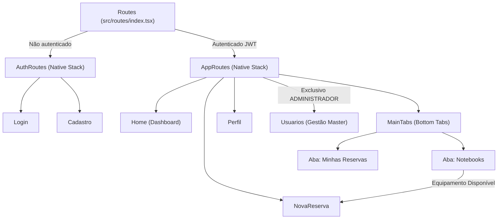

# 💻 AlocaNote Mobile


Aplicação frontend multiplataforma (**Android**, **iOS** e **Web**) do **AlocaNote** — sistema corporativo de gestão, agendamento e rastreabilidade de empréstimos de notebooks voltado para a equipe interna de uma loja de móveis planejados (**Projetistas**, **Conferentes**, **Consultores de Vendas**, **Administradores** e demais colaboradores).

O aplicativo centraliza a disponibilidade de máquinas de alto desempenho (como equipamentos para renderização de projetos 3D, conferência técnica em obra e apresentações comerciais), garantindo rastreabilidade completa desde a solicitação até o **check-in geolocalizado** de retirada e a **devolução auditada com foto e GPS**.

---

## 📌 Índice

- [Funcionalidades Principais](#-funcionalidades-principais)
- [Tecnologias e Bibliotecas Utilizadas](#-tecnologias-e-bibliotecas-utilizadas)
- [Pontos Importantes e Decisões Técnicas](#-pontos-importantes-e-decisões-técnicas)
- [Arquitetura do Projeto](#-arquitetura-do-projeto)
- [Fluxo de Navegação e Perfis de Acesso](#-fluxo-de-navegação-e-perfis-de-acesso)
- [Integração com a API (Endpoints)](#-integração-com-a-api-endpoints)
- [Variáveis de Ambiente](#-variáveis-de-ambiente)
- [Como Executar o Projeto](#-como-executar-o-projeto)
- [Build e Deploy (EAS & Vercel)](#-build-e-deploy-eas--vercel)
- [Licença](#-licença)

---

## ✨ Funcionalidades Principais

### 🔐 Autenticação, Cadastro e Sessão Persistente
- **Cadastro de Colaboradores**: Formulário validado com confirmação de e-mail, máscara dinâmica de telefone integrada ao seletor internacional de DDI (`🇧🇷 +55`, `🇺🇸 +1`, `🇵🇹 +351`, `🇪🇸 +34`, `🇦🇷 +54`, `🇺🇾 +598`, `🇵🇾 +595`) e seleção de cargo corporativo (`Projetista`, `Conferente`, `Consultor de Vendas` ou `Outros` com descrição personalizada).
- **Autenticação Híbrida**: Suporte a login/registro via **Firebase Authentication** (E-mail/Senha com envio de verificação e OAuth Google) integrado ao backend, além de **fallback transparente** para autenticação JWT direta na API própria (permitindo uso imediato com contas locais/seed como `admin@alocanote.com`).
- **Persistência Automática de Sessão**: Armazenamento seguro de credenciais JWT e dados do usuário via `AsyncStorage` (`@alocanote:token` e `@alocanote:user`), restaurando a sessão automaticamente na abertura do app e sincronizando os dados atualizados via `GET /users/me`.

### 💻 Catálogo e Agendamento de Notebooks
- **Visualização em Tempo Real**: Listagem performática (`FlatList` com *Pull-to-Refresh*) exibindo identificação, especificações de hardware e indicadores visuais por status:
  - 🟢 `DISPONIVEL` — Liberado para novo agendamento.
  - 🟠 `EM_USO` — Alocado no momento por outro colaborador.
  - 🔴 `MANUTENCAO` — Bloqueado para reparo técnico.
- **Nova Reserva (`NovaReserva`)**: Pré-seleção automática do equipamento escolhido, máscaras de entrada para data (`DD/MM/AAAA`) e horário (`HH:mm`), validação cronológica e conversão para `ISO-8601`, além do registro obrigatório da finalidade de uso.

### 📍 Check-in Geolocalizado e Devolução Auditada por Foto
- **Check-in de Retirada (`AGENDADO` → `CHECKED_IN`)**:
  - Definição do tipo de retirada: **Na Loja** (`LOJA`) ou **Outro Local** (`OUTRO_LOCAL`, ex: cliente/obra).
  - Captura automática de coordenadas GPS de alta precisão (`expo-location` no mobile e `navigator.geolocation` na Web).
  - **Geocodificação Reversa em Camadas**: Conversão de coordenadas em endereço legível usando o serviço nativo do sistema operacional (Google Play Services / CoreLocation) com fallback automático para a API do **OpenStreetMap Nominatim**.
  - **Busca Inteligente por CEP ou Endereço**: Integração direta com **ViaCEP** (para CEPs brasileiros de 8 dígitos) combinada ao Nominatim, além de atalho direto para abrir e conferir a localização no **Google Maps**.
- **Devolução / Finalização (`CHECKED_IN` → `FINALIZADO`)**:
  - Ao iniciar a devolução, o app captura automaticamente o local atual de entrega e aciona a câmera nativa (`expo-image-picker`, com alternativa para galeria em emuladores/web).
  - **Foto Comprobatória Obrigatória**: Exige o registro fotográfico do notebook (comprimido e codificado em Base64) antes de concluir a devolução, criando histórico auditável com data/hora, endereço, link para o Google Maps e miniatura da foto no card da reserva.
- **Cancelamento (`CANCELADO`)**: Permite cancelar agendamentos pendentes antes do check-in.

### 👤 Meu Perfil
- Atualização de foto de perfil via galeria (`1:1`, convertida em Data URI Base64).
- Edição de informações cadastrais (nome, telefone, cargo e descrição de cargo customizado).
- Alteração segura de senha mediante confirmação da senha atual.

### 🛡️ Painel Administrativo Master (`ADMINISTRADOR`)
Quando autenticado com perfil `ADMINISTRADOR`, a interface habilita controles exclusivos de gestão corporativa:
- **Gestão de Usuários**: Busca instantânea por nome, e-mail ou telefone; cadastro direto de novos colaboradores; alteração de cargos/permissões; e exclusão de contas (com trava de segurança impedindo autoexclusão ou remoção do administrador mestre `admin@alocanote.com`).
- **Gestão de Ativos (Notebooks)**: Criação de novos equipamentos, edição de nome/configuração técnica, alteração manual de status (incluindo `MANUTENCAO`) e exclusão de notebooks.
- **Visão Master de Reservas**: Visualização centralizada com identificação do colaborador solicitante em cada agendamento.

---

## 🛠 Tecnologias e Bibliotecas Utilizadas

### Core & Linguagem
| Tecnologia | Versão | Finalidade no Projeto |
| :--- | :--- | :--- |
| **React Native** | `0.88.0` | Framework principal para renderização nativa Android e iOS |
| **Expo** | `~58.0.19` | Ecossistema, SDK de APIs nativas, bundler Metro e workflows de build |
| **React** | `19.3.0` | Biblioteca base de componentização, Hooks e Context API |
| **TypeScript** | `~6.0.3` | Tipagem estática estrita (`strict: true`) em 100% dos arquivos (`.ts` / `.tsx`) |
| **React Native Web** | `^0.21.4` | Compatibilidade e exportação da aplicação como SPA para navegadores Web |

### Roteamento, Rede e Estado
| Biblioteca | Versão | Finalidade no Projeto |
| :--- | :--- | :--- |
| `@react-navigation/native` | `^7.4.1` | Container principal e gerenciamento de estado de navegação |
| `@react-navigation/native-stack` | `^7.19.2` | Navegação em pilha para fluxos de autenticação e aprofundamento de telas |
| `@react-navigation/bottom-tabs` | `^7.19.2` | Barra de abas inferior (`Notebooks` e `Minhas Reservas`) |
| `axios` | `^1.20.0` | Cliente HTTP centralizado com interceptors de autenticação Bearer e tratamento de erros |
| `@react-native-async-storage/async-storage` | `2.2.0` | Persistência local assíncrona do token JWT e perfil do usuário |
| `firebase` | `^13.0.0` | Autenticação em nuvem (E-mail/Senha e provedor Google OAuth) |

### Recursos Nativos, UI e Utilitários Expo
| Biblioteca | Versão | Finalidade no Projeto |
| :--- | :--- | :--- |
| `expo-location` | `~58.0.19` | Permissões de GPS, captura de coordenadas e geocodificação reversa nativa |
| `expo-image-picker` | `~58.0.10` | Captura de foto pela câmera na devolução do notebook e seleção de avatar na galeria |
| `expo-linear-gradient` | `~58.0.3` | Gradientes visuais nos cards e botões de destaque da `Home` |
| `@expo/vector-icons` | `^15.0.2` | Pacotes de ícones vetoriais (`Ionicons`, `Feather`, `MaterialCommunityIcons`) |
| `react-native-safe-area-context` | `~5.10.1` | Tratamento seguro de entalhes (*notches*), barras de status e áreas de sistema |
| `react-native-screens` | `~4.30.0` | Otimização nativa de memória e transições de telas |
| `expo-auth-session` / `expo-web-browser` / `expo-crypto` | `~58.0` | Suporte a fluxos OAuth e sessões de autenticação seguras |
| `expo-linking` | `~58.0.14` | Deep linking (`scheme: alocanote`) e abertura externa do Google Maps |
| `@expo/ngrok` | `^4.1.3` | Suporte ao modo `--tunnel` para testes em dispositivos físicos fora da mesma sub-rede |

### Serviços Externos Integrados
- **ViaCEP (`viacep.com.br`)**: Consulta automática de logradouro, bairro, cidade e UF a partir do CEP informado no check-in ou devolução.
- **OpenStreetMap Nominatim (`nominatim.openstreetmap.org`)**: Geocodificação direta e reversa sem necessidade de chave proprietária para conversão entre endereços e coordenadas `lat/lon`.
- **Google Maps Universal Links**: Abertura direta das coordenadas exatas ou endereço registrado no app nativo ou navegador.

---

## 🎯 Pontos Importantes e Decisões Técnicas

1. **UI 100% Nativa Pura (`StyleSheet.create`)**:
   - O projeto **não utiliza bibliotecas pesadas de componentes de terceiros** (como NativeBase, Tamagui ou Tailwind/NativeWind). Toda a interface foi construída exclusivamente com primitivos nativos do React Native (`View`, `Text`, `Pressable`, `FlatList`, `Modal`, `ScrollView`, `KeyboardAvoidingView`) e `StyleSheet.create`.
   - Todas as interações de toque utilizam o componente moderno `<Pressable>` com feedback visual dinâmico baseado no estado `{ pressed }`.
   - Listagens dinâmicas utilizam estritamente `<FlatList>` (evitando gargalos de memória com `<ScrollView>`).

2. **Resolução Dinâmica e Inteligente da URL da API (`src/services/api.ts`)**:
   - A função `resolveApiBaseUrl()` elimina dores de cabeça comuns no desenvolvimento mobile/nuvem seguindo uma cadeia automática de prioridades:
     1. **Produção em Nuvem (`HTTPS`)**: Se `EXPO_PUBLIC_API_URL` iniciar com `https://`, utiliza imediatamente o endpoint remoto sem sobrescrevê-lo por IPs locais.
     2. **Desenvolvimento via Expo Go / Web Local**: Detecta automaticamente o IP da máquina host através de `NativeModules.SourceCode.scriptURL` (ignorando URLs de túnel `.exp.direct` ou `.ngrok`) ou `window.location.hostname` na Web, conectando-se à porta `:8082`.
     3. **Variável Local `.env`**: Usa o endereço HTTP configurado localmente, normalizando automaticamente a porta do backend (`:8082`).
     4. **Fallback LAN**: Utiliza IP local padrão de contingência caso nenhuma das opções anteriores esteja disponível.
   - Um **Request Interceptor** do Axios revalida a `baseURL` e injeta automaticamente o cabeçalho `Authorization: Bearer <token>` a partir do `AsyncStorage` em todas as chamadas.

3. **Polyfill de `Alert.alert` para Web (`index.ts`)**:
   - No `react-native-web`, a API `Alert.alert` padrão não exibe diálogos nativos para múltiplos botões de confirmação. O arquivo `index.ts` implementa um **polyfill customizado** para `Platform.OS === 'web'` que converte alertas informativos em `window.alert` e modais de decisão (ex: confirmar cancelamento, exclusão ou logout) em `window.confirm`, acionando os respectivos callbacks `onPress`.

4. **Isolamento de Regras de Negócio e Contratos Tipados**:
   - Nenhuma tela executa chamadas HTTP diretas ao Axios: toda comunicação passa pela camada `src/services/`.
   - Todos os DTOs de requisição/resposta e Enums (`Role`, `NotebookStatus`, `ReservationStatus`) espelham fielmente os contratos do backend em `src/types/index.ts`.

---

## 📂 Arquitetura do Projeto

```text
alocanote-mobile/
├── assets/                          # Ícones adaptativos, splash screen, favicon e logotipo
├── src/
│   ├── components/                  # Componentes visuais reutilizáveis e desacoplados
│   │   ├── NotebookCard/            # Card de exibição rápida de notebook e status
│   │   ├── PrimaryButton/           # Botão padrão com variantes (primary, danger, secondary, outline) e loading
│   │   └── SeletorPais/             # Modal seletor de país + bandeira + DDI para telefone
│   ├── constants/
│   │   └── paises.ts                # Lista estática de países e códigos DDI suportados
│   ├── contexts/
│   │   └── AuthContext.tsx          # Contexto global de autenticação, sessão AsyncStorage e perfil
│   ├── routes/                      # Configuração de navegação (React Navigation v7)
│   │   ├── index.tsx                # Switch entre AuthRoutes e AppRoutes conforme autenticação
│   │   ├── auth.routes.tsx          # Stack público (Login, Cadastro)
│   │   └── app.routes.tsx           # Stack autenticado + Bottom Tabs (Home, Notebooks, Reservas, Perfil, Usuários)
│   ├── screens/                     # Telas completas da aplicação
│   │   ├── Login/                   # Autenticação do colaborador
│   │   ├── Cadastro/                # Criação de conta com validação e seleção de cargo
│   │   ├── Home/                    # Dashboard inicial adaptativo (Colaborador vs Admin)
│   │   ├── Perfil/                  # Edição de foto, dados pessoais e senha
│   │   ├── Usuarios/                # Painel Master de gestão de colaboradores (Admin)
│   │   ├── Notebooks.tsx            # Catálogo de equipamentos + CRUD administrativo em modal
│   │   ├── NovaReserva.tsx          # Formulário de agendamento de equipamento
│   │   └── MinhasReservas.tsx       # Gestão do ciclo de vida, Check-in GPS e Devolução com Foto
│   ├── services/                    # Camada isolada de comunicação externa e API
│   │   ├── api.ts                   # Instância Axios, resolução de URL, interceptors e parser de erros
│   │   ├── authService.ts           # Login, registro e integração Firebase/Google com backend
│   │   ├── firebase.ts              # Inicialização e métodos do Firebase Auth
│   │   ├── notebookService.ts       # Endpoints CRUD de notebooks
│   │   ├── reservationService.ts    # Endpoints de criação, listagem, check-in, devolução e cancelamento
│   │   ├── userService.ts           # Endpoints de perfil próprio (/users/me) e gestão de usuários
│   │   └── locationService.ts       # Consulta de locais cadastrados e busca por CEP no backend
│   └── types/
│       ├── index.ts                 # Enums e interfaces DTO espelhando o backend
│       └── navigation.d.ts          # Tipagem global das rotas do React Navigation
├── App.tsx                          # Providers globais (SafeAreaProvider, AuthProvider, Routes)
├── index.ts                         # Entry point Expo + Polyfill Web para Alert.alert
├── app.json                         # Manifesto Expo, permissões de GPS e plugins nativos
├── eas.json                         # Perfis de build nativo (APK / Release) no Expo Application Services
├── vercel.json                      # Configuração de build estático e rewrites SPA para deploy na Vercel
├── .npmrc                           # Configuração legacy-peer-deps para instalação consistente
└── tsconfig.json                    # Configuração TypeScript estrita
```

---

## 🧭 Fluxo de Navegação e Perfis de Acesso

A navegação combina **Stack Navigation** (para fluxos hierárquicos e telas modais/aprofundamento) e **Bottom Tab Navigation** (para alternância rápida entre o catálogo de equipamentos e os agendamentos):



### Papéis de Usuário (`Role`)
| Cargo (`Enum Role`) | Permissões no Aplicativo |
| :--- | :--- |
| `PROJETISTA` | Consultar notebooks, criar reservas, realizar check-in GPS, devolver com foto, cancelar reservas próprias e editar seu perfil. |
| `CONFERENTE` | Mesmas permissões operacionais de agendamento, retirada externa/interna e devolução auditada. |
| `CONSULTOR_VENDAS` | Mesmas permissões operacionais para uso em atendimento e apresentação de projetos. |
| `OUTROS` | Mesmas permissões operacionais, permitindo especificar um título de cargo personalizado (`customRole`). |
| `ADMINISTRADOR` | **Acesso Master**: todas as permissões acima + CRUD completo de Notebooks (incluindo status de manutenção), CRUD e alteração de cargos de Usuários e painel gerencial de Reservas. |

---

## 🔌 Integração com a API (Endpoints)

A aplicação consome uma API REST própria (por padrão na porta `8082` em ambiente local ou via URL HTTPS em nuvem):

| Domínio | Método | Rota | Descrição |
| :--- | :---: | :--- | :--- |
| **Auth** | `POST` | `/auth/login` | Autenticação tradicional por e-mail e senha (retorna JWT) |
| **Auth** | `POST` | `/auth/register` | Cadastro de novo colaborador |
| **Auth** | `POST` | `/auth/firebase` | Validação/sincronização de `idToken` do Firebase Auth no backend |
| **Auth** | `POST` | `/auth/google` | Autenticação social com credencial Google OAuth |
| **Usuários** | `GET` | `/users/me` | Retorna os dados completos do colaborador autenticado |
| **Usuários** | `PUT` | `/users/me` | Atualiza foto, dados cadastrais ou senha do próprio colaborador |
| **Usuários** | `GET` | `/users` | Lista todos os colaboradores cadastrados *(Admin)* |
| **Usuários** | `POST` | `/users` | Cadastra colaborador diretamente pelo painel *(Admin)* |
| **Usuários** | `PUT` | `/users/{id}` | Atualiza cargo/permissões de um colaborador *(Admin)* |
| **Usuários** | `DELETE` | `/users/{id}` | Remove um colaborador *(Admin)* |
| **Notebooks** | `GET` | `/notebooks` | Lista todos os notebooks e seus respectivos status |
| **Notebooks** | `GET` | `/notebooks/{id}` | Detalhes de um notebook específico |
| **Notebooks** | `POST` | `/notebooks` | Cadastra novo equipamento *(Admin)* |
| **Notebooks** | `PUT` | `/notebooks/{id}` | Edita informações ou status de manutenção *(Admin)* |
| **Notebooks** | `DELETE` | `/notebooks/{id}` | Exclui equipamento *(Admin)* |
| **Reservas** | `POST` | `/reservations` | Cria um novo agendamento de notebook |
| **Reservas** | `GET` | `/reservations` | Lista reservas do usuário (ou visão gerencial conforme perfil) |
| **Reservas** | `GET` | `/reservations/all` | Lista todas as reservas corporativas |
| **Reservas** | `PATCH` | `/reservations/{id}/check-in` | Registra retirada com tipo de local, endereço e latitude/longitude |
| **Reservas** | `PATCH` | `/reservations/{id}/finish` | Finaliza reserva com local de devolução, coordenadas e foto Base64 |
| **Reservas** | `PATCH` | `/reservations/{id}/cancel` | Cancela um agendamento pendente |
| **Reservas** | `DELETE` | `/reservations/{id}` | Exclui permanentemente um registro de reserva |
| **Locais** | `GET` | `/locations` | Lista unidades/locais pré-cadastrados |
| **Locais** | `GET` | `/locations/cep/{cep}` | Consulta endereço por CEP via backend |

---

## 🔑 Variáveis de Ambiente

Crie um arquivo `.env` na raiz do projeto (ele já está listado no `.gitignore`) para configurar a URL da API e, opcionalmente, as credenciais do Firebase/Google:

```env
# URL base da API Backend (HTTPS de produção ou HTTP com IP da máquina local na porta 8082)
EXPO_PUBLIC_API_URL=http://192.168.18.9:8082

# (Opcional) Configurações do Firebase Authentication
EXPO_PUBLIC_FIREBASE_API_KEY=
EXPO_PUBLIC_FIREBASE_AUTH_DOMAIN=
EXPO_PUBLIC_FIREBASE_PROJECT_ID=
EXPO_PUBLIC_FIREBASE_STORAGE_BUCKET=
EXPO_PUBLIC_FIREBASE_MESSAGING_SENDER_ID=
EXPO_PUBLIC_FIREBASE_APP_ID=

# (Opcional) Client IDs para Login com Google OAuth
EXPO_PUBLIC_GOOGLE_WEB_CLIENT_ID=
EXPO_PUBLIC_GOOGLE_ANDROID_CLIENT_ID=
EXPO_PUBLIC_GOOGLE_IOS_CLIENT_ID=
```

> **Nota**: Caso as variáveis `EXPO_PUBLIC_FIREBASE_*` não sejam preenchidas, o aplicativo opera normalmente utilizando a autenticação JWT direta com o backend (`/auth/login` e `/auth/register`).

---

## 🚀 Como Executar o Projeto

### Pré-requisitos
- **Node.js** (versão LTS recomendada: 20+) e **npm**.
- Aplicativo **Expo Go** instalado no celular (Android/iOS), ou um emulador Android Studio / simulador Xcode configurado, ou navegador Web moderno.
- Backend do **AlocaNote** em execução (localmente na porta `8082` ou hospedado em nuvem).

### Passo a Passo

1. **Clone o repositório e acesse a pasta do projeto:**
   ```bash
   git clone https://github.com/lanussehelena/alocanote-mobile.git
   cd alocanote-mobile
   ```

2. **Instale as dependências:**
   *(O arquivo `.npmrc` já configura `legacy-peer-deps=true` automaticamente)*
   ```bash
   npm install
   ```

3. **Configure o ambiente (opcional se estiver na mesma rede Wi-Fi com Expo Go):**
   Crie o arquivo `.env` conforme a seção [Variáveis de Ambiente](#-variáveis-de-ambiente).

4. **Inicie o servidor de desenvolvimento:**

   - **Modo Túnel (recomendado para testar no celular via QR Code mesmo em redes diferentes):**
     ```bash
     npm start
     ```
   - **Executar no Emulador Android:**
     ```bash
     npm run android
     ```
   - **Executar no Simulador iOS (macOS):**
     ```bash
     npm run ios
     ```
   - **Executar no Navegador Web:**
     ```bash
     npm run web
     ```

---

## 📦 Build e Deploy (EAS & Vercel)

### Deploy Web (Vercel)
O projeto já possui o arquivo `vercel.json` configurado para exportação estática SPA do Expo Web:
- **Comando de instalação**: `npm install --legacy-peer-deps`
- **Comando de build**: `npx expo export --platform web`
- **Diretório de saída**: `dist`
- **Rewrites**: Redireciona todas as rotas `/(.*)` para `/index.html`.

### Build Nativo Android (EAS Build)
O arquivo `eas.json` inclui perfis prontos para geração de pacote instalável (`.apk`) ou versão de produção via **Expo Application Services**:
```bash
# Instalar o EAS CLI globalmente (caso não possua)
npm install -g eas-cli

# Gerar APK Android de testes/homologação (perfil preview)
eas build --platform android --profile preview

# Build de produção
eas build --platform android --profile production
```

---

## 📄 Licença

Este projeto está sob a licença **MIT**. Consulte o arquivo [LICENSE](./LICENSE) para mais detalhes.
